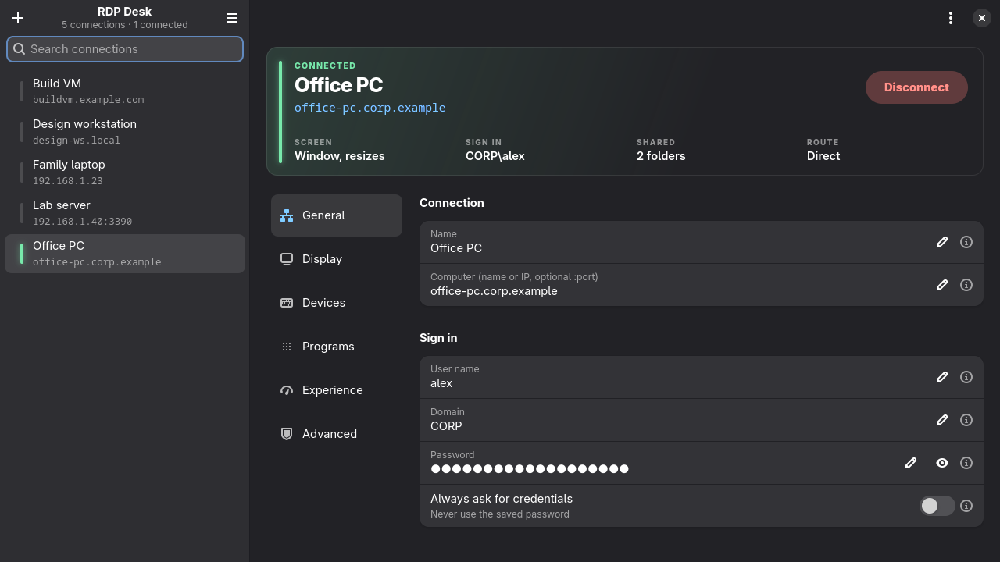
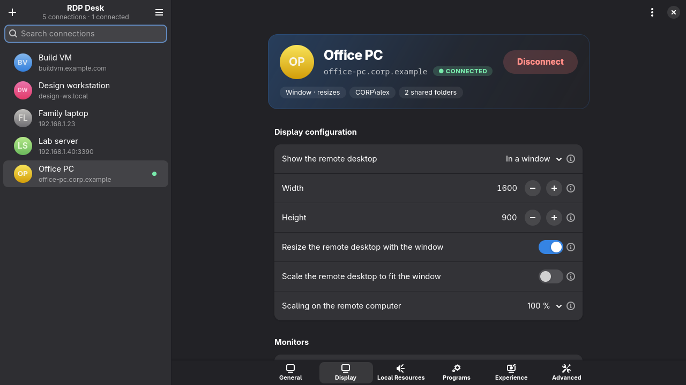
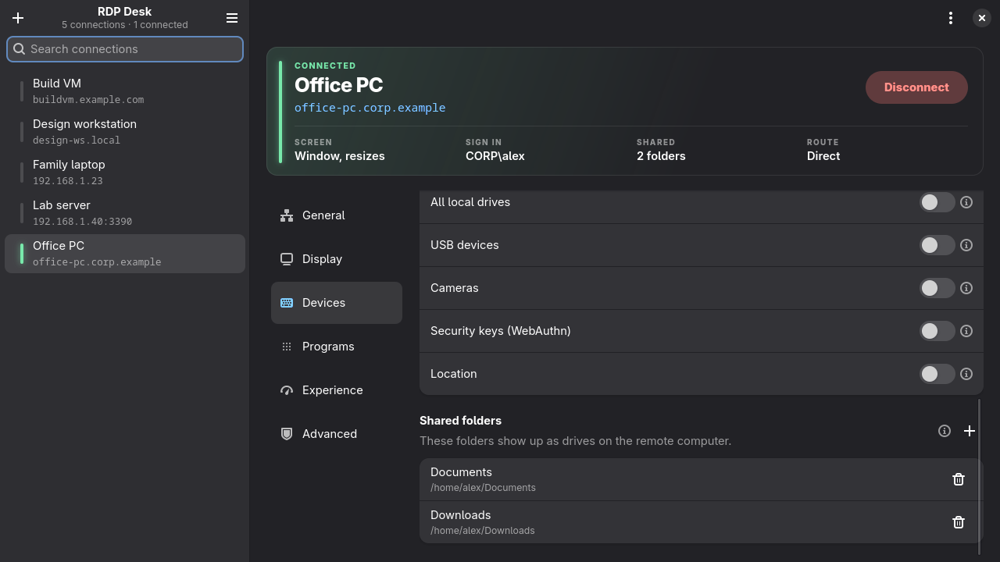
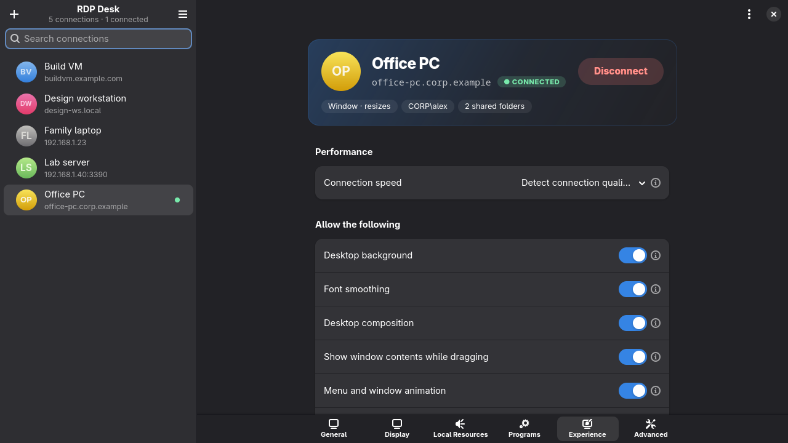
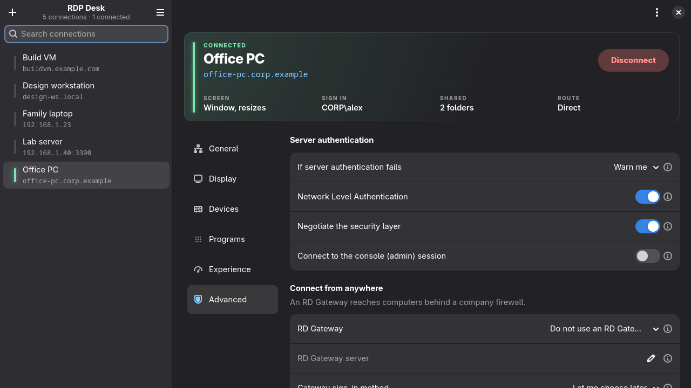
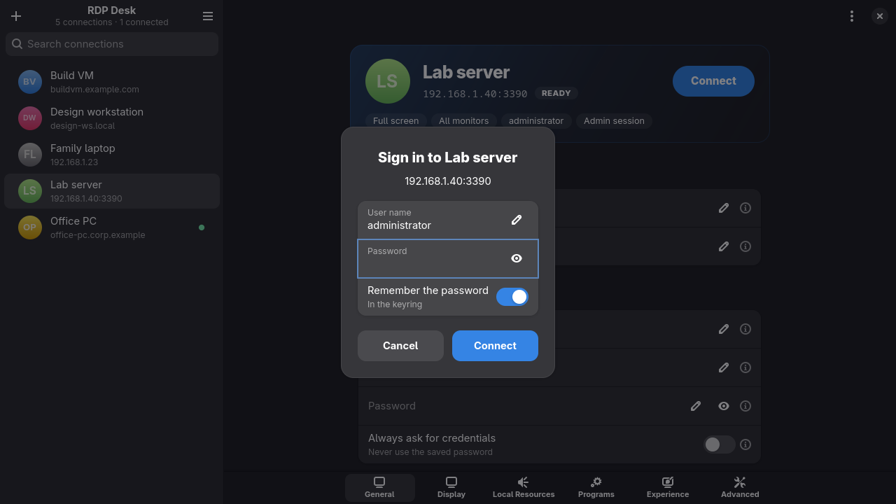
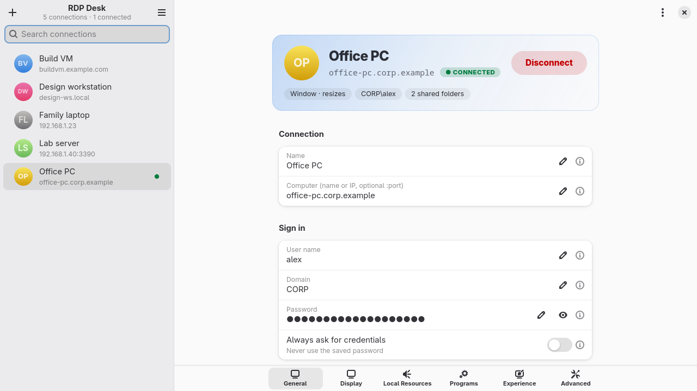

# RDP Desk

**Keep, edit and open Remote Desktop (RDP) connections on Linux.**
A small GTK 4 / libadwaita app with the settings the Windows Remote Desktop client has, laid out in the same six sections. FreeRDP makes the connections.



## Features

- **Your connections in one list**, each with a status light that glows green while connected. Search them, and double-click one to connect. Each session opens in its own window, so several can run at once.
- **A header card for every connection**: status (*Ready*, *Connected*, *Needs a computer*), name, address and one big Connect button, over a strip that sums up the setup at a glance: *Screen*, *Sign in*, *Shared* and *Route*. Below it, the sections sit in a column beside the settings; in narrow windows they move to a bar at the bottom, and in short ones the card goes compact.
- **Every setting the Windows client has: 54 in all, in six sections** (the Windows client's tabs, with *Local Resources* called *Devices*). General, Display, Devices, Programs, Experience and Advanced. That includes multiple monitors, remote scaling, audio and microphone, clipboard, printers, drives, USB devices, cameras, security keys, RemoteApp, the performance options, Network Level Authentication and RD Gateway.
- **A help icon on every setting.** Hover the ⓘ to see what the setting does and when you would change it.
- **Shared folders.** Pick folders such as Downloads or a NAS share. They appear on the remote computer as drives.
- **Plain `.rdp` files.** Connections are stored in the format Windows uses:
  - import files from Windows or your IT department, or drop them onto the window,
  - export them back,
  - double-click any `.rdp` file in your file manager to connect.

  Settings the app doesn't know are kept as they are.
- **Passwords stay in your keyring** (GNOME Keyring, KWallet or KeePassXC), never in the `.rdp` file. They reach FreeRDP through a pipe, so they never show up in the process list.
- **Clear errors.** A failed connection explains itself in plain words ("Wrong user name or password", "The computer did not answer…") instead of FreeRDP's error codes.
- **Light and dark**, following your desktop. The window adapts down to phone-sized widths.

## Screenshots

| | |
|---|---|
|  |  |
| **Display**: window or full screen, resolution, scaling, monitors | **Devices**: audio, keyboard, devices, shared folders |
|  |  |
| **Experience**: connection speed and visual effects | **Advanced**: server authentication, NLA, RD Gateway |
|  |  |
| Asks for the password when none is saved | Light style |

## Install

### Arch Linux and Arch-based distributions
EndeavourOS, Manjaro, CachyOS, Garuda and others:

```sh
git clone https://github.com/arcje-acrh/RDP-Desk.git
cd RDP-Desk/pkg && makepkg -si
```

This installs the `rdpdesk` package with its dependencies: `python-gobject gtk4 libadwaita libsecret freerdp` and a keyring. If you have no keyring yet, pacman asks which one to install. To remove it: `sudo pacman -R rdpdesk`.

### Other distributions
Install the dependencies, then run `make install`:

| Distribution | Packages |
|---|---|
| Debian 13 / Ubuntu 24.04 or newer | `python3-gi gir1.2-adw-1 gir1.2-gtk-4.0 gir1.2-secret-1 freerdp3-sdl freerdp3-x11 gnome-keyring` |
| Fedora | `python3-gobject gtk4 libadwaita libsecret freerdp gnome-keyring` |

```sh
sudo make install        # into /usr/local; `sudo make uninstall` removes it
```

It needs GTK ≥ 4.12, libadwaita ≥ 1.5, Python ≥ 3.10 and FreeRDP 3.

## Using it

- **New connection** (＋ or Ctrl+N): type the computer's name or IP address in the General section and press the big **Connect** button in the header card. That's all. Everything else has sensible defaults.
- **Import** (☰ › Import, Ctrl+O, or drag files onto the window) copies `.rdp` files into your list.
- **Connect**: the Connect button, a double-click in the list, or Ctrl+Enter. Press it again (**Disconnect**) to end the session.
- **Passwords**: type it in the Password row and press Enter to save it in the keyring. Leave it empty and you're asked when connecting, with an option to remember it.
- **Hide RDP Desk while connected** (☰ menu, a tick-box): Connect hides RDP Desk so only the remote desktop is open; it comes back when the session ends, however it ends (Disconnect, closing the remote window, a dropped connection or a failed sign-in).
- **Quitting with sessions open** asks first, like a browser closing several tabs: *Disconnect 2 sessions and quit?*
- **More** (⋮): Duplicate, Export and Delete as icon buttons, and Copy the address.
- **Search**: Ctrl+F.

Changes are saved as you make them. Connections live in `~/.local/share/rdpdesk/` as ordinary `.rdp` files.

## The settings, in short

Every setting has a hover help icon in the app. In brief:

| Section | What you set there |
|---|---|
| **General** | Name, computer (name or IP, optional `:port`), user name, domain, password, *always ask for credentials* |
| **Display** | Window or full screen, size, *resize the remote desktop with the window*, scale to fit, remote scaling (any value from 100 to 500 %), all monitors / span / pick monitors, colour depth, connection bar |
| **Devices** | Where sound plays, microphone, audio quality; where Windows key shortcuts go; clipboard, printers, smart cards, serial ports, all drives, USB devices, cameras, security keys, location; shared folders |
| **Programs** | Start a program instead of the desktop; RemoteApp (one program window, no desktop) |
| **Experience** | Connection speed (auto-detect), graphics acceleration (turn off if the picture flickers), wallpaper, font smoothing, composition, window dragging, animations, visual styles, bitmap caching, automatic reconnect |
| **Advanced** | What to do with an unverified server certificate, Network Level Authentication, security layer negotiation, console (admin) session, RD Gateway |

## Passwords and the keyring

Saved passwords need a keyring that your login unlocks. GNOME, KDE, Cinnamon and most desktops set this up already.

On **minimal setups** (Hyprland or Sway with greetd, ly or a TTY login), add the keyring to your login's PAM file once, for example `/etc/pam.d/greetd`:

```
auth       optional     pam_gnome_keyring.so                # after the "auth include" line
session    optional     pam_gnome_keyring.so auto_start     # after the "session include" line
```

Then log out and back in. Without it, GNOME Keyring asks for a separate keyring password the first time you save one.

If you log in by fingerprint or face, the keyring has no password to open with. The first app that needs it then asks for your login password, once per login.

## How it works

RDP Desk is one Python file (`rdpdesk.py`). It reads and writes `.rdp` files, shows the settings, and starts FreeRDP 3 for each session with `/args-from:stdin`. The connection file, the password and the shared folders go to FreeRDP on its standard input, never on the command line.

- **Windowed sessions** use FreeRDP's SDL client (`sdl-freerdp3`), which resizes with its window and asks about unknown certificates.
- **Full-screen sessions** use the X11 client (`xfreerdp3`), because SDL's full screen currently fails on Wayland.
- **Choosing the client yourself:** set `RDPDESK_FREERDP=<client>`.
- **Shared folders** are kept in the `.rdp` file under an extra key, `rdpdesk folders`. Windows and FreeRDP ignore it.

## Troubleshooting

- **"FreeRDP 3 is not installed"**: install your distribution's FreeRDP 3 package (`freerdp` on Arch, `freerdp3-sdl` on Debian/Ubuntu).
- **"The computer did not answer"**: check the address, that Remote Desktop is turned on on that computer (Settings › System › Remote Desktop), and that a firewall allows port 3389.
- **"Security negotiation failed"**: try switching *Network Level Authentication* in the Advanced section.
- **The picture flickers or flashes black** (often after a Windows update, especially in VMs): turn off *Graphics acceleration* in the Experience section.
- **A certificate warning on every connect**: normal for home PCs with a self-signed certificate. Set *If server authentication fails* to *Connect and don't warn me* only on networks you trust.

## Development

```sh
python3 rdpdesk.py            # run from the checkout
make check                    # self-check: .rdp parsing, FreeRDP arguments, error messages, settings
python3 docs/screenshots.py   # regenerate the screenshots (needs cage; runs hidden, with demo data)
```

## License

MIT, see [LICENSE](LICENSE).
